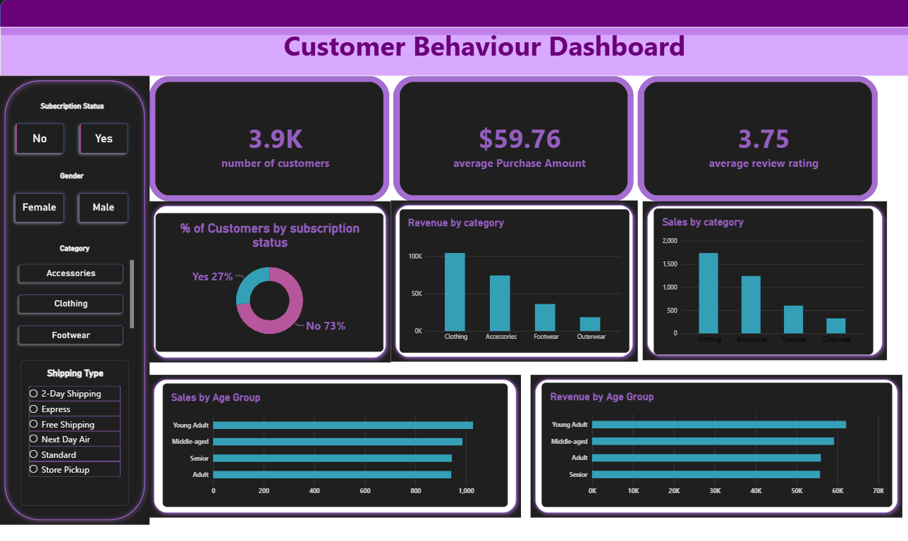

# Customer Behaviour Analysis

## Project Overview
This project analyses customer purchasing behaviour to identify trends, understand customer preferences, and generate useful business insights. It uses SQL, Python and Power BI to explore the data and build an interactive dashboard.

## Business Problem
Understand how customers shop, which product categories and age groups drive sales and revenue, and how subscription status relates to purchasing.

## Dashboard

## Tools & Technologies
- **SQL:** data querying, cleaning and analysis
- **Python:** data analysis and processing
- **Power BI:** interactive dashboard and data visualization
- **Jupyter Notebook:** Python development and analysis
- **Excel/CSV:** dataset

## Project Objectives
- Analyse customer purchasing patterns
- Understand customer subscription behaviour
- Identify popular product categories
- Analyse sales and revenue by category
- Explore customer behaviour across age groups
- Present key metrics through an interactive dashboard

## Key Performance Indicators (KPIs)
- **Total Customers:** 3.9K
- **Average Purchase Amount:** $59.76
- **Average Review Rating:** 3.75

## Dashboard Features
- Customer subscription status analysis
- Revenue by product category
- Sales by product category
- Sales by age group
- Revenue by age group
- Interactive filters for subscription status, gender, category and shipping type

## Key Findings
- 73% of customers do not have a subscription.
- Clothing brings the most revenue and sales among the categories.
- Young Adults are the top age group for sales and revenue.

## Project Workflow
1. Imported and explored the customer dataset
2. Cleaned and prepared the data
3. Used SQL to query and analyse the data
4. Used Python for further analysis
5. Built an interactive Power BI dashboard
6. Visualised purchasing patterns and key metrics

## Files Included
- `Customer_Shopping_Behavior_Analysis.ipynb`: Python analysis notebook
- `customer_behavior_queries.sql`: SQL queries
- `customer analysis behavior.pbix`: Power BI dashboard
- `customer_shopping_behavior.csv.xls`: dataset
- `customer-behaviour-dashboard..png`: dashboard screenshot
- `Business Problem Document.pdf`: problem statement
- `Customer Shopping Behavior Analysis report.pdf`: detailed analysis report
- `Customer-Shopping-Behavior-Analysis.pdf`: project summary

## How to View the Project
1. Download the `.pbix` file and open it in Power BI Desktop (free to download).
2. Open the `.ipynb` file in Jupyter Notebook or on GitHub to see the Python analysis.
3. Open the `.sql` file to see the queries.

## Conclusion
This project shows how SQL, Python and Power BI can be used together to analyse customer data, identify purchasing patterns, and share findings through interactive visualizations.

## Author THRISHNA TC aspiring data analyst|BCA gradute|GitHub:thrishna2003
**Thrishna T C**
Aspiring Data Analyst | BCA Graduate
GitHub: thrishna2003
